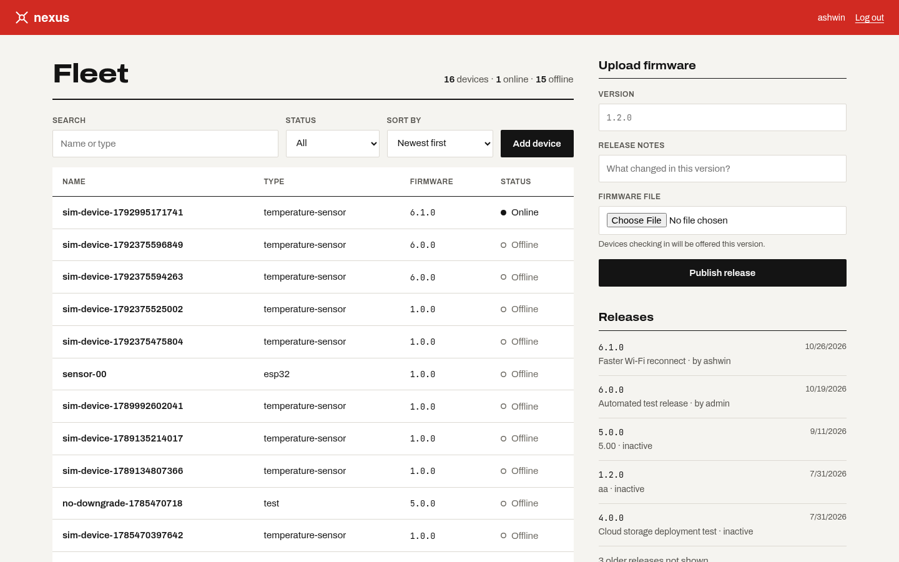
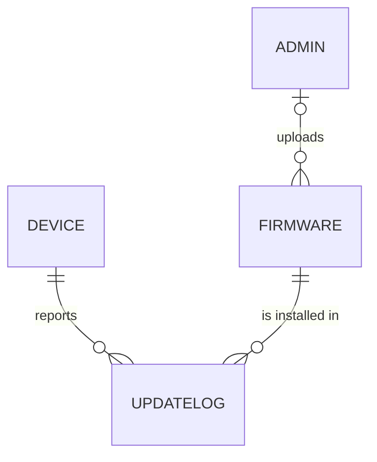
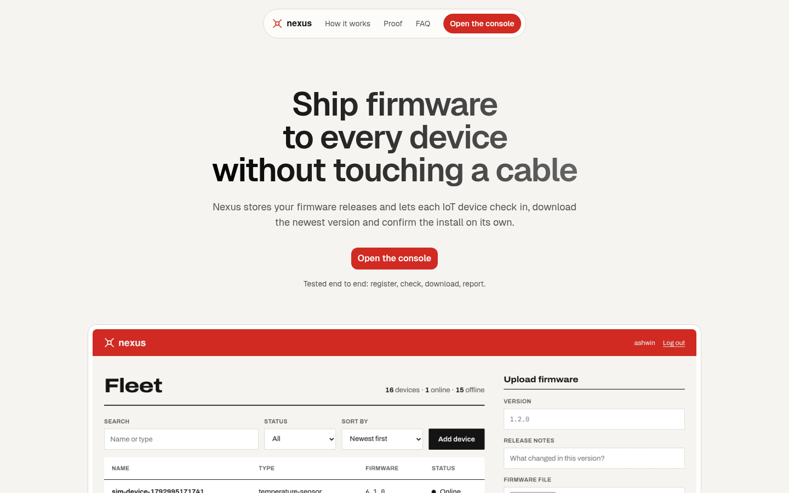
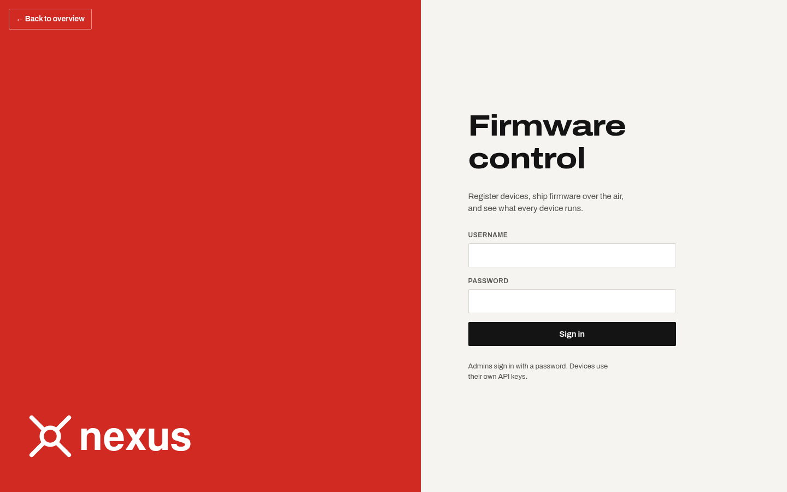
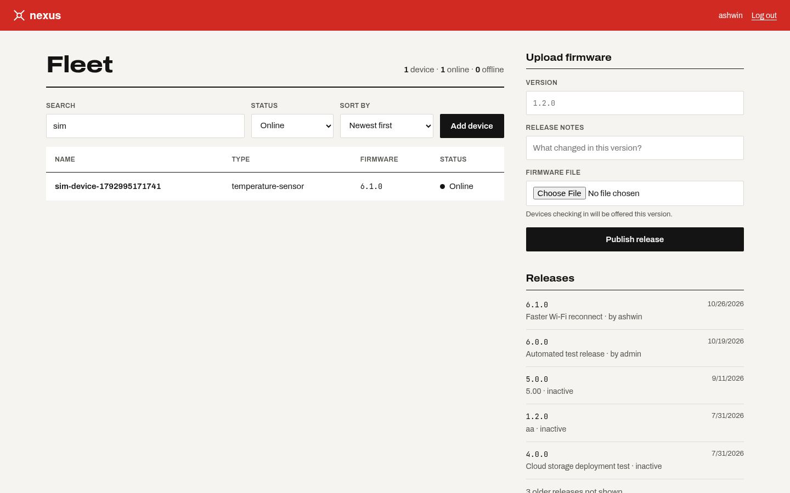
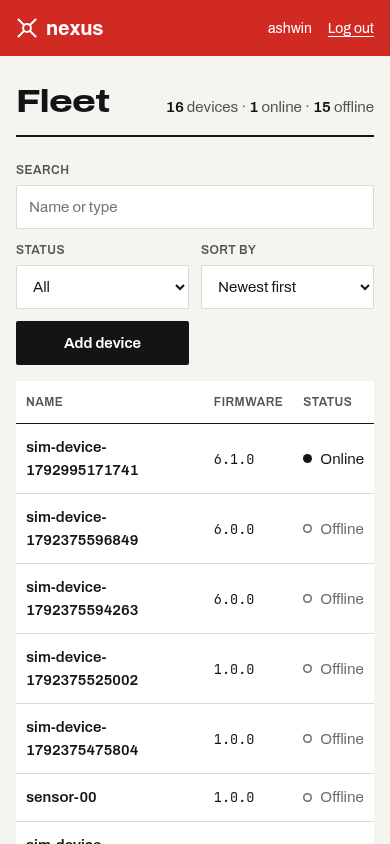
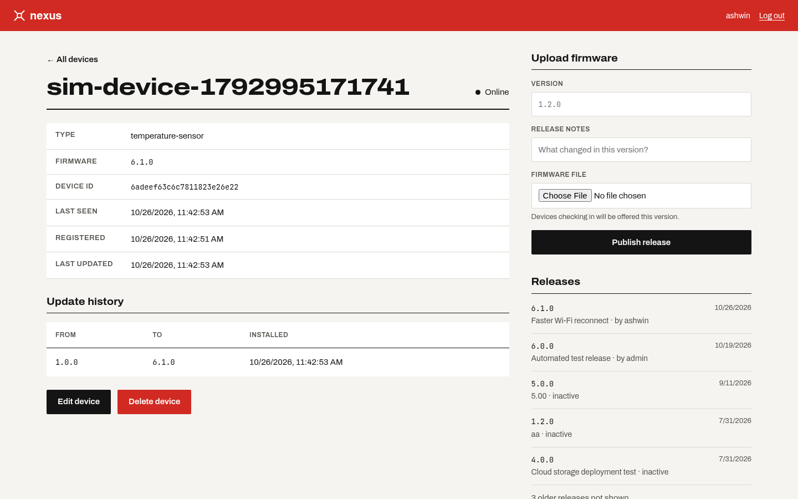
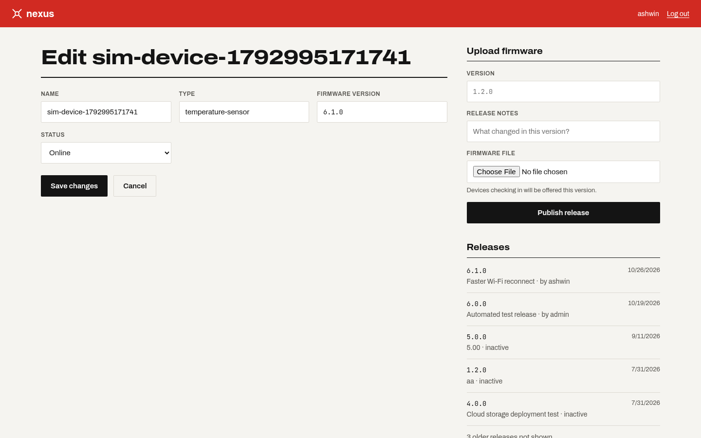
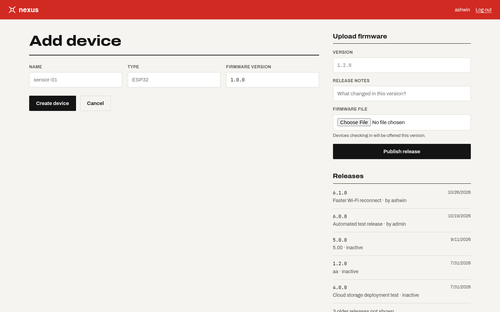

# Nexus

A web platform for managing IoT devices and pushing firmware updates to them
**over the air (OTA)**. Admins register devices, publish firmware releases and see
what every device runs. Devices check in over a REST API, download newer firmware
and report the install back. Think *"app store for firmware"* for a fleet of devices.

Built for **EC4307 — Web Application Development** (University of Ruhuna).



## Features

| Area | What you can do |
|---|---|
| **Create** | Add a device from the dashboard (or a device registers itself through the API). Upload a firmware release. |
| **Read** | Fleet table with **search** (name or type), **status filter** and **sort** (newest, oldest, name, status). Device **detail view** with its update history. Releases list. |
| **Update** | Edit a device's name, type, firmware version and status. |
| **Delete** | Delete a device after a confirmation prompt; its update history is removed with it. |
| **Validation** | Same rules in the browser (HTML constraints) and on the server (Mongoose schema). Clear 400/404/409 messages instead of crashes. |
| **OTA loop** | A simulated device registers → checks for an update → downloads it → reports the install. |
| **Status** | Devices that stop checking in for 5 minutes are marked offline automatically. |
| **Security** | Admins log in with bcrypt-hashed passwords and get a JWT. Devices use their own API key. |
| **Landing page** | A public page explains the product and the update loop before the visitor opens the console. |

## Tech stack
- **Frontend:** React 18 + Vite (single-page app, custom CSS, self-hosted fonts)
- **Backend:** Express 5 on the Bun runtime
- **Database:** MongoDB Atlas through Mongoose
- **Auth:** JWT (admins) + per-device API keys
- **Tests:** `bun test` (schema validation rules)

## Running it locally

You need [Bun](https://bun.sh) and a MongoDB connection string (a free Atlas cluster works).

**1. Configure the backend.** Copy `backend/.env.example` to `backend/.env` and set:

| Variable | Value |
|---|---|
| `MONGODB_URI` | Your Atlas connection string, ending in `/nexus?...` |
| `JWT_SECRET` | A long random string, e.g. from `openssl rand -hex 32` |
| `PORT` | `3000` (the frontend proxy expects this) |

**2. Start the backend** (terminal 1):

```bash
cd backend
bun install
bun run dev
```

**3. Start the frontend** (terminal 2), then open `http://localhost:5173` and click **Open the console**:

```bash
cd frontend
bun install
bun run dev
```

**4. Create the first admin** (once per database):

```bash
curl -X POST http://localhost:3000/api/auth/register \
  -H "Content-Type: application/json" \
  -d '{"username":"admin","password":"choose-a-password"}'
```

**5. Run the simulated device** (from the repository root, with the backend running).
Upload a firmware release from the dashboard first, so there is something to download:

```bash
bun simulator/device.js
```

The new device then appears online in the fleet, and its detail view shows the update.

**Tests:**

```bash
cd backend
bun test
```

## Database design




Four MongoDB collections, linked by ObjectId references
(source: [`docs/erd.mmd`](docs/erd.mmd), models in [`backend/models/`](backend/models)):

- **Admin** — a person who manages the fleet. `username` is unique; the password is stored only as a bcrypt hash.
- **Device** — one IoT device. `name` and `apiKey` are unique; the key is hidden from every read. `lastSeen` drives the online/offline status.
- **Firmware** — one release. `version` is unique and must look like `1.2.0`. `uploadedBy` references the Admin who published it (one admin → many releases).
- **UpdateLog** — one install. It references a Device and a Firmware, which turns the many-to-many "which device installed which release" into two one-to-many relationships. `fromVersion` records the version before the update.

Deleting a device also deletes its UpdateLogs, so no log points at a missing device.

## API

| Method | Path | Access | Purpose |
|---|---|---|---|
| `POST` | `/api/auth/register` | Public | Create an admin account |
| `POST` | `/api/auth/login` | Public | Log in, returns a JWT |
| `GET` | `/api/devices?search=&status=&sort=` | Public | List devices (search, filter, sort) |
| `POST` | `/api/devices/register` | Public | Create a device, returns its API key once |
| `GET` | `/api/devices/:id` | Public | One device plus its update history |
| `PUT` | `/api/devices/:id` | Admin JWT | Edit a device |
| `DELETE` | `/api/devices/:id` | Admin JWT | Delete a device and its history |
| `POST` | `/api/devices/check-update` | Device key | Ask whether newer firmware exists |
| `POST` | `/api/devices/report-update` | Device key | Report an installed firmware version |
| `POST` | `/api/firmware` | Admin JWT | Upload a release (multipart: `file`, `version`, `releaseNotes`) |
| `GET` | `/api/firmware` | Public | List releases with their uploader |
| `GET` | `/api/firmware/:id/download` | Public | Download a release's file |
| `GET` | `/health` | Public | Server health check |

Admin requests send `Authorization: Bearer <token>`. Device requests send `x-api-key: <key>`.

## Screenshots

| | |
|---|---|
|  Landing page |  Login |
|  Search + status filter |  Phone layout |
|  Device detail and update history |  Edit device |
|  Add device | |

## Project layout
```
Nexus/
├── backend/
│   ├── config/        # database connection
│   ├── controllers/   # request logic (auth, devices, firmware)
│   ├── middleware/    # JWT and device-key checks
│   ├── models/        # Mongoose schemas + tests
│   ├── routes/        # URL → controller mapping
│   └── server.js      # entry point
├── frontend/
│   └── src/           # React components, api.js helper, styles, fonts
├── simulator/         # simulated IoT device (full OTA loop)
├── docs/
│   ├── images/        # ERD and screenshots
│   ├── erd.mmd        # ERD source (Mermaid)
│   ├── PROGRESS.md    # phase plan + decisions log
│   └── study-guide/   # module theory mapped to this code
└── LEARNING.md        # plain-English glossary
```

## Known limitations
- Anyone who can reach the API can create an admin account (`/api/auth/register` has no setup guard).
- Firmware downloads are public; files live on the backend's local disk (`backend/uploads/`).
- Update selection offers the newest *active* release whenever its version string differs from the device's, so it could offer an older version.
- The dashboard does not refresh live; reload or change a filter to see new check-ins.
