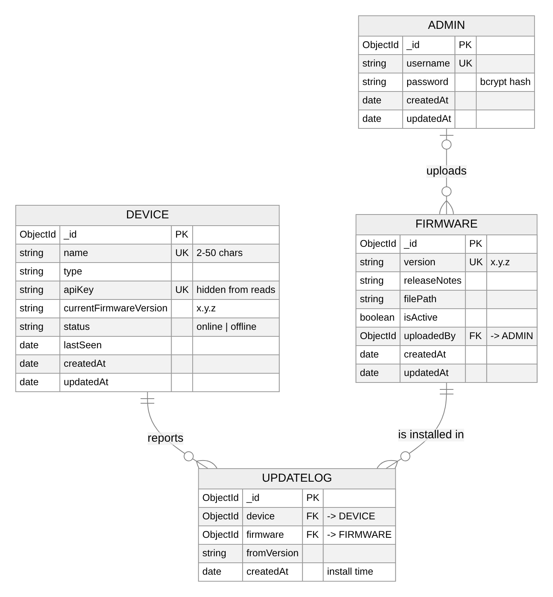

# 03 — Backend and database

[Guide index](README.md) · Next: [Authentication and security](04-authentication-and-security.md)

## Follow a request through the backend

The project uses separation of concerns similar to MVC: models represent data, controllers implement request logic, and React provides the view. Express does not render server-side page templates here.

```text
server.js → route → optional authentication middleware → controller → model
                                                               ↓
                                                         MongoDB Atlas
Firmware upload/download also reads or writes a file in backend/uploads/.
```

A **route** connects a method and URL to handlers. **Middleware** runs before or after a handler; it can modify `req`, respond immediately, or call `next()`. A **controller** implements the operation. A **model** supplies schema-backed database methods.

[`backend/server.js`](../../backend/server.js) creates the Express app, registers JSON parsing, routes and `/health`, then connects to Atlas before listening on port 3000 by default. Route order matters, and a failed startup database connection prevents the API from starting.

## JavaScript concepts used here

`import` and `export` divide code into modules. An object groups named values, such as `{name, type}`. Destructuring extracts those values from `req.body`. `async` functions return promises; `await` pauses that function until a result arrives without blocking all other requests. `try/catch` handles rejected promises and other exceptions.

Waiting for database I/O can overlap with other requests. CPU-heavy synchronous work can still delay the event loop. Using `async` does not automatically make every computation parallel.

## The stored records

MongoDB stores documents in collections. BSON is its binary document format; it can represent values such as dates and ObjectIds. Mongoose adds application schemas and convenient query methods.

| Model | Key fields | Purpose |
|---|---|---|
| [`Admin`](../../backend/models/Admin.js) | Unique username, password hash, timestamps | Human administrator identity |
| [`Device`](../../backend/models/Device.js) | Unique name, type, API key, current version, status, lastSeen | Registry record |
| [`Firmware`](../../backend/models/Firmware.js) | Unique version, filePath, notes, isActive, uploadedBy | Release metadata and local file path |
| [`UpdateLog`](../../backend/models/UpdateLog.js) | device, firmware, fromVersion, createdAt | One reported install |

`required`, `minlength`, `maxlength`, `match` (a regular expression) and `enum` validate document fields, each with a readable message. `unique: true` requests a database unique index; it is not a validator. A duplicate device name therefore comes back from MongoDB as error code 11000, which the controller turns into `409 Conflict`. Using the index instead of a "find first" check also avoids a race between two simultaneous requests.

`find()` returns matching records, `findOne()` finds one and `create()` saves a new document. `findByIdAndUpdate(..., { runValidators: true })` edits a record with the same rules as creation, and `findByIdAndDelete()` removes one. ObjectIds identify records. The firmware document's `filePath` points to a file on the backend's disk.

## Relationships between collections



MongoDB has no foreign-key constraints, but a field can store another document's ObjectId with `ref`, and `populate()` swaps that id for the referenced document when reading.

- **Admin → Firmware (one to many):** `Firmware.uploadedBy` stores the uploading admin's id. The release list populates it to show the username.
- **Device → UpdateLog ← Firmware:** a device can install many releases and a release can be installed on many devices. That many-to-many relationship is stored as a separate UpdateLog collection, one document per install, each referencing one device and one firmware. The device detail view populates the firmware version for each log.

Because there are no database-level constraints, the application keeps references consistent: deleting a device also deletes its UpdateLogs.

## Where the firmware file goes

[`firmwareRoutes.js`](../../backend/routes/firmwareRoutes.js) uses Multer disk storage in `backend/uploads/`. The controller saves the path in the Firmware document, and the download route serves the file from that path.

The upload route first authenticates the administrator. Multer then writes one file to disk. The controller checks that a version was provided, is not already recorded and matches `x.y.z`, then saves metadata. If any check fails, the controller deletes the file Multer already saved, so rejected uploads do not pile up. There is still no upload size limit.

Local disk means the firmware metadata and binary must stay together on the same backend machine. GridFS or object storage could be explored later, but neither is implemented in this commit.

Express `res.download()` reads the stored file path and sends it to the client.

**Self-check:** What happens if the file in `backend/uploads/` is deleted but its MongoDB record remains? The release metadata still exists, but the download returns `404` with a message saying the file is missing.
